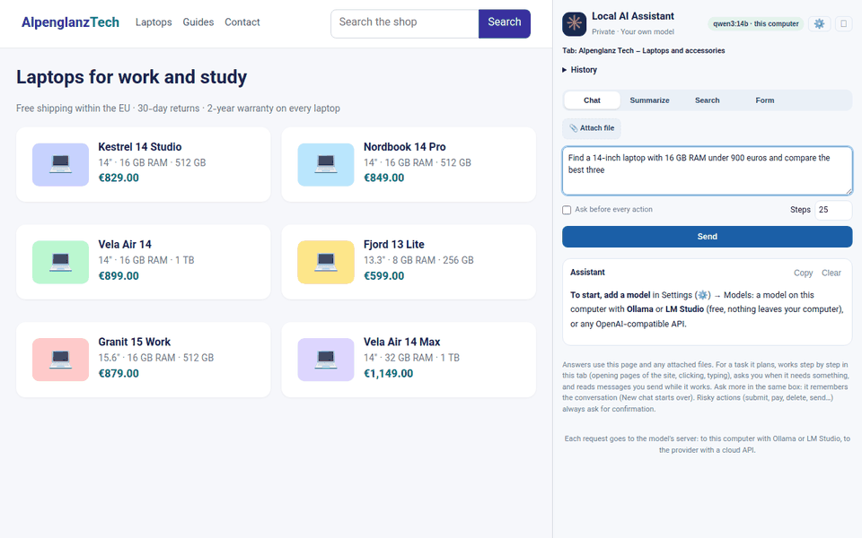
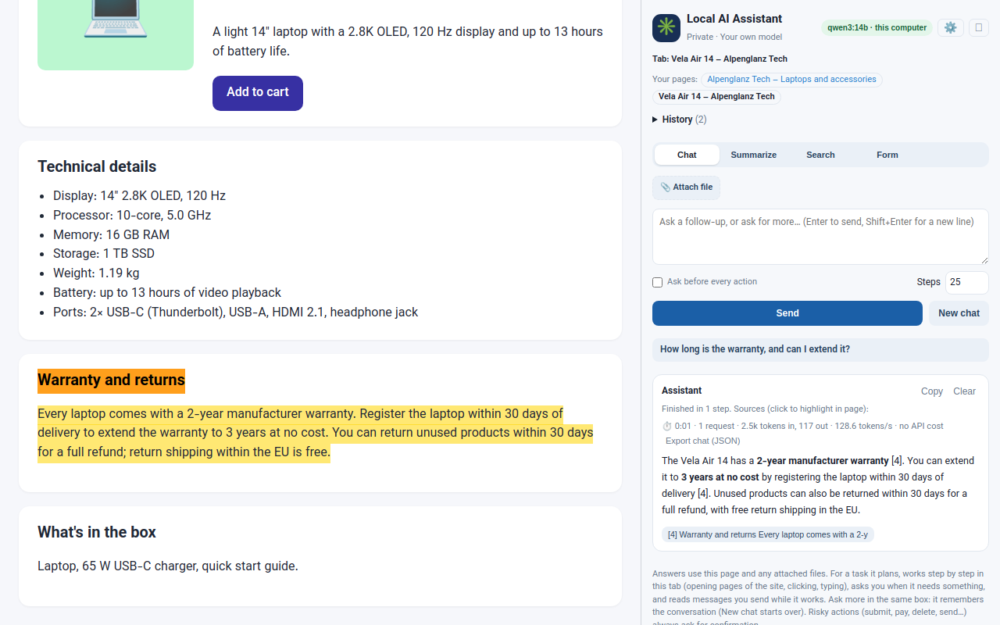
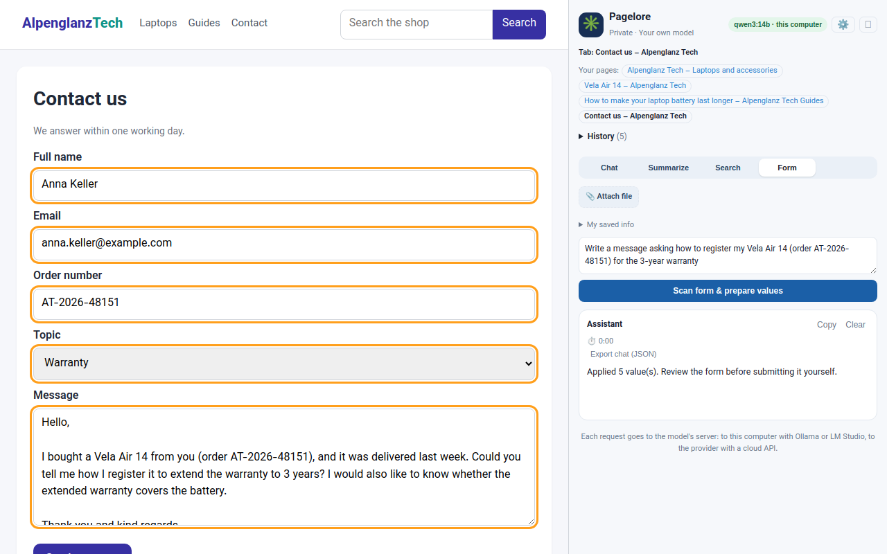
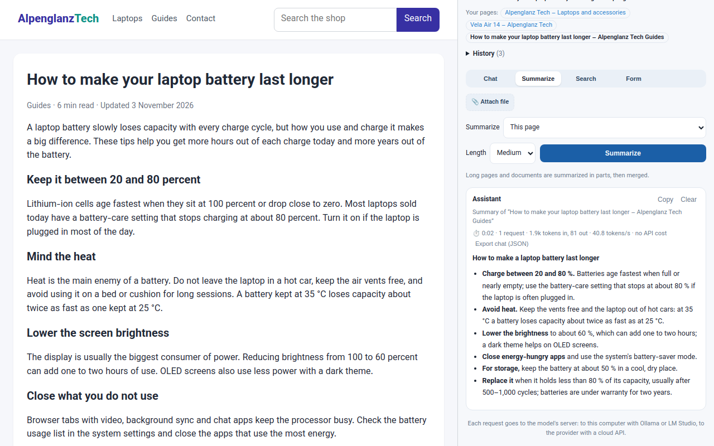
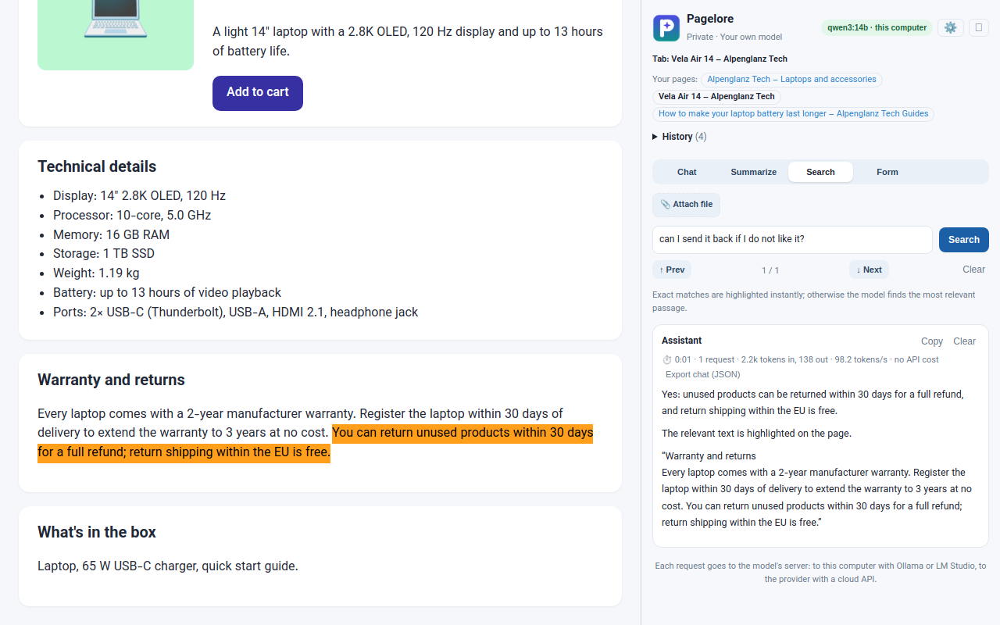

<h1 align="center">
  <br>
  Pagelore
</h1>

<p align="center">
  <b>An AI assistant in Chrome's side panel that works with the page you are on,<br>using the model you choose: on your own computer or through any OpenAI-compatible API.</b>
</p>

<p align="center">
  
  
  
  <a href="LICENSE"></a>
</p>

<p align="center">
  
  <br><sub>“Find a 14-inch laptop with 16 GB RAM under 900 euros and compare the best three”: the agent plans, searches the site, reads three product pages and compares them.</sub>
</p>

## Why

- **Your model, your data.** Point it at [Ollama](https://ollama.com) or [LM Studio](https://lmstudio.ai) and pages, files and questions never leave your computer. Or use any OpenAI-compatible API (OpenAI, OpenRouter, Requesty…). There is no developer server, no account and no analytics.
- **It acts, not just chats.** A tool-calling agent plans a task, searches the site, reads pages, clicks and types, keeps notes and returns results with links it actually saw. Submitting, paying or deleting always asks you first.
- **Answers you can check.** Answers cite the page, and a click on a source highlights it in the page.
- **Built for local models.** The agent's memory stays compact (notes instead of page dumps) and long pages are summarized in parts, so requests stay small enough for models of 8B parameters and up running on your own machine. With APIs, requests are laid out to get the most from prompt caching.

<table>
  <tr>
    <td width="50%"><br><b>Ask about the page.</b> Answers cite their sources; a click highlights them.</td>
    <td width="50%"><br><b>Fill forms</b> from your saved info and files, and have messages written. You review every value; the form is never submitted.</td>
  </tr>
  <tr>
    <td width="50%"><br><b>Summarize</b> long articles, PDFs and Word files.</td>
    <td width="50%"><br><b>Search by meaning.</b> Exact matches are found instantly; otherwise the model finds the passage that answers you.</td>
  </tr>
</table>

<sub>The screenshots show a fictional demo shop, recorded with a scripted stand-in for the model so the run is repeatable.</sub>

## Quick start

1. Download `pagelore-<version>.zip` from [Releases](https://github.com/majid-rafei/pagelore/releases/latest) and unzip it, or build it yourself with `npm install && npm run build` (the output is `dist/`). Then load the folder in `chrome://extensions` (Developer mode → **Load unpacked**).
2. Start Ollama and pull a model: `ollama pull qwen3:8b`.
3. Click the extension icon on any page, open ⚙ Settings → **Models** → **Add a model** → **Ollama**, pick the model, **Test**, **Save**.

Details: [Build & load](#build--load) and [Models](#models).

## Features

| Feature | What it does |
|---|---|
| **Chat** | One box for questions about the page and for tasks (see [Chat](#chat)). It is an agent that answers questions about the page and the attached files (the passages most relevant to the question go with its first step; answers cite sources, and a click on a source highlights it in the page) and does tasks: it plans, searches the site, reads and opens pages, clicks and types, keeps notes, asks you when it needs something, and reads messages you send while it works. Risky steps (submit, pay, delete, send…) always ask for confirmation. It works as a chat: the box empties after each message, follow-ups remember the conversation, and “New chat” starts over. |
| **Summarize** | Reads the page's main content and summarizes it (short / medium / detailed). Long articles are summarized in parts (map-reduce) and merged, so a 20-page article fits a small model. |
| **Search** | Exact matches are found instantly without the model, with Unicode normalization (case, accents, invisible characters and digits of any script are ignored, so “Muller” finds “Müller”), and every hit is highlighted with Prev/Next navigation. If nothing matches literally, the model picks the most relevant passage, quotes it and answers, and the quote is highlighted. |
| **Form** | Detects fields (text, email, date, select, radio groups, checkboxes) with their labels. Fills them from your saved info and/or an instruction. `key: value` lines are matched deterministically, and the model handles the rest. Multi-line fields that the instruction names (e.g. “write the message”) are written by the model from your saved info, attached files and the page; check these texts carefully, since small models tend to add or mix up details. You review and edit every value before applying. The form is never submitted. |
| **Attachments** | Attach PDF, DOCX or TXT files (button or drag & drop). They're read locally and become a shared context source for every feature: Chat searches the page and the files together, Summarize can target any attached file, Form fills fields from the file's relevant excerpts (plus regex-extracted emails, phones and profile links), and the agent gets the excerpts relevant to the request. Files belong to the tab they were attached in and stay in memory only while the panel is open. |
| **A panel per tab** | Click the extension icon on a tab to open a panel for that tab. Each tab has its own panel: conversation, output, attachments, search hits, form preview and running task. Tabs where you did not click the icon show no panel; switching back to a tab shows its panel again, and a task keeps running on its tab while you use other tabs (or their panels). Closing a panel ends its session (chats are kept in History). |
| **History** | Above the tabs: chats, summaries, searches and form fills, newest first, each marked with its type. Click one to open it in its tab: chats continue from there; a search or form fill brings back its query or instruction and earlier result, to run again on the current page. Saved in this browser only (chrome.storage.local, the last 100), with the questions, answers and form values. |
| **Your pages** | Under “Tab:”, links to the pages you asked on in this tab, by their titles, so the page a task started on is one click away after the agent moved elsewhere. A click opens the page again in the tab (in a new tab while the agent is working); they are saved with the history entry too. |
| **Settings** | The ⚙ button in the header opens the Settings page (← Back or Esc returns): the model of the tab and its reasoning level, answer language and writing style, the agent's pace and compaction, and the models. The header shows the tab's model and where it runs (this computer or API); clicking it opens Settings too. |

## Chat

Ask about the open page in the **Chat** tab (“What is the warranty?”), or write what should be done, for example “Find a 14-inch laptop with 16 GB RAM under 900 euros and compare the best three”, “Find the opening hours of the Munich store” or “Collect the dates and prices of the courses on this site”. The agent works on the tab where you started it, so you can watch it.

The model must support tool calling (most current models do; in Ollama, models marked “tools”). The agent:

- **answers page questions in one request.** The passages of the open page most relevant to your message go with its first step (for that step only). When they answer a question, it replies right away and cites them, and the cited passages can be highlighted in the page. Otherwise it uses its tools.

- **plans a task first.** It writes a plan with steps and substeps, keeps it up to date and follows it. The plan is shown in the panel. When it gives its final answer, a last step about giving the answer (“Present the list”) and steps whose substeps are all done are marked done, since models often answer without updating the plan.
- **works with tools:** read the page, list the elements of the page, click / type / select / check / scroll, search the site with its own search box, list the items of a result page, and open a page of the site.
- **keeps notes instead of page text.** Pages are read as their visible text, not HTML. Each request holds the task, the last step in full (the model's tool calls and their results) and a short state: your messages, a one-line log of every earlier step, the plan, notes, results and current page. So a page's text is seen for one step only: the model records what matters in its notes, and pages with nothing useful leave just their log line. Repeating the same read on the same page is pointed out to the model. Requests stay about the same size however many pages it reads. Servers with prompt caching bill the part of a request that starts the same as the request before at the cached price, so the request is laid out to keep that part long: instructions, task and conversation first, then the memory, which only grows at its end (the log of earlier steps with each note written where it was taken, then the saved results), then the last step and the state, which are new every time. A page's text in the last step is always new input, so a task that reads many long pages has a smaller cached share.
- **asks you.** When the request lacks something that decides the result, a choice is yours, or it is stuck, it stops and asks a question. Type the answer below the question and it continues.
- **continues as a conversation.** After it finishes, type a follow-up in the same box (“which one is lightest?”, “is there one with 32 GB?”) and press Enter or click Send. It keeps its plan, notes, results and log, so it answers from what it found, and only browses for what that does not cover. The latest answer and its plan, notes and steps are shown under the box; earlier questions and answers follow below, newest first, each in its own folded card that shows the question on one line. Click it to open it: the question in full, its time and cost, the answer, and its plan, notes, results and steps (folded) as they were at the end of that answer. **New chat** starts over. Each question is sent with the page open in the tab (address and title), so after you go to another page you can ask about it (“what does this page say about shipping?”) and the agent reads it.
- **keeps a history.** Every conversation is saved in the panel's History (see below) after each answer, with the agent's memory and the text of the files attached in it, so a long search is not lost when the browser closes. Open it from History to see it and continue it: its files are attached again (a file attached or removed later is saved with the chat right away).
- **listens while it works.** Send a message at any time (“only Lenovo”, “skip the reviews”): it reads it at its next step.
- **stays on the site.** It opens pages of the starting site only (subdomains included). Another site is possible only with “Allow access” for all sites, and only after you confirm. When you click Send, Chrome may ask for access to the whole site.
- **goes easy on websites.** It opens pages at most once every few seconds (Settings → Agent → “Pause between page loads”, default 3 s), so it puts no more load on a site than a person browsing it.
- **hands CAPTCHAs to you.** When a page shows a CAPTCHA, a bot check (“unusual traffic”, “are you a robot”, Cloudflare's “Just a moment…”) or a rate limit (HTTP 429), the agent stops and brings the tab to the front. Solve the check yourself and click **Continue**, or click **Finish with what was found** to get an answer from what it has gathered so far. The agent never solves CAPTCHAs and does not try to look like a person: a CAPTCHA inside a login or contact form does not stop it, but it never logs in anyway.
- **asks before risky steps.** Submitting, buying, paying, deleting, sending or posting always needs your confirmation (pressing Enter in a search box does not: it only runs a search). The confirmation box scrolls into view and pulses, so a waiting task is easy to spot. Tick “Ask before every action” to confirm every step. It never types passwords or payment details. Page text is untrusted: instructions written on a page are ignored.

**Compaction.** In a long task or chat the requests grow with the log, the notes and the earlier conversation. Settings → Agent → “Compact its memory above” (a number of tokens you type, default 60,000; 0 turns it off, and smaller values such as 16,000 make long tasks cheaper) sets a limit: when a request would be larger, and the older part is a good share of it, one extra request first summarizes the older conversation, the older steps of the log and the notes (keeping names, prices, links and what was already done). The latest answer and follow-up, the last steps, the plan and the saved results stay as they are. The summary is saved with the conversation. A step line in the log shows the size before and after. A follow-up also starts with the earlier work compacted when it is large (only its last three steps stay in full), so the new work does not send all of it again with every step.

**Nothing is lost when the panel closes.** The agent's progress (steps, plan, notes, results) is saved in the history after every step. If the panel is closed or the extension reloads mid-task, open the chat from the history and send a message such as “continue”: the agent goes on from where it stopped.

**Checked links.** The agent may only give links it actually saw: in a page, a result list or a message from the user. `save_result` refuses a URL that never appeared (a model easily writes a plausible URL from memory) and a site's home page given as an item's page. A result whose page the agent did not read is marked “page not opened: not checked”. Before finishing, the agent is sent back once to fix unknown links or unread results; links that are still unknown are removed from the answer, with a note.

**Model log.** Settings → Answers → “Keep a log of the model's requests and replies” records every request sent to the model and its reply. The request is the body exactly as it was sent (the messages, the tool definitions and the other fields) and the reply exactly as it came back (with its token counts). In a chat there is one file per question and its answer: “Download model log” under the answer saves the current one, and each earlier question's card has its own button. The file is named like the chat's JSON export, with `-q<number>-model-log.txt` at the end. Every request is written in full, so a page shown to the model for one step is in that request and missing from the next, as it was sent. Before each request a line says how much of it starts the same as the request before (the part a server can cache) and where the first difference is: the message, the character and the memory section, with the text before and after. The log is kept in the panel's memory only (cleared by “New chat” or when the panel closes, at most 500 requests) and has no API keys.

**Export.** “Export chat (JSON)” under the answer, and “Export” on each History entry, save the entry as a JSON file: the questions and answers with their steps and time/cost line, the pages, and for chats the agent's memory (plan, notes, results with their links, log, summary, the conversation, and the saved info and file excerpts it was given). When the chat is the one open in the tab and a model log was kept, it is included as `modelLog`. The file never has API keys, but it can have your saved info.

Each step is one request to the model, and the step limit (default 25, up to 40 to start with) caps the cost. It is not a hard stop: when the steps left are not enough for its plan, the agent asks for more, with what is left to do, and if it reaches the limit with work still open in its plan, the panel asks you itself. You allow more steps (as often as you like) or click “Finish now” to get the answer from what it found so far. If a model still ends without calling finish, the last answer it wrote is shown. Plan steps left open when a run ends are marked “not done”. Your saved info and the relevant parts of attached files are sent with the task, so the agent can use them when a value is needed. The request (and each follow-up) also names the attached files, and the agent reads a whole file with its `read_file` tool when it matters, for example your CV for a job application (long files in parts of 12,000 characters; like a page, the text is shown to the model for one step). While it works, **■ Stop** (next to Send) ends the run at once, and **⏸ Pause** holds the agent before its next step (the request already sent finishes first) until you click **▶ Continue**; a message you send while it is paused is read when it continues.

## Requirements

- Google Chrome 116+ (CSS Custom Highlight API and side panel)
- Node.js 20.19+ (to build)
- A model: Ollama or LM Studio on this computer (or another one on your network), or an account with an OpenAI-compatible API

## Build & load

```bash
npm install
npm run build
```

1. Open `chrome://extensions`, enable **Developer mode**, click **Load unpacked**, and select `dist/`.
2. Open a normal web page and click the extension icon to open the side panel.
3. Open Settings (⚙) → **Models** and add a model (see below). Exact-match Search works without one.

The first time you use a page, Chrome may ask for site access (the **Allow access** banner). The extension requests `<all_urls>` as an *optional* permission, only when needed. Without it, it works on the tab where you clicked the extension icon (`activeTab`).

## Models

The extension contains no model. Settings → **Models** → **Add a model** adds any model served by an OpenAI-compatible API (`…/v1/chat/completions`): on this computer with Ollama or LM Studio, or in the cloud (OpenAI, OpenRouter, Requesty, DeepInfra, Vultr…). Enter a name, the API URL (for example `https://router.requesty.ai/v1`), the API key (not needed on this computer) and the model name; **List models** fetches the server's model list, **Test** sends one short request.

### A model on this computer

**Ollama**

1. Install Ollama from [ollama.com](https://ollama.com) and start it (or run `ollama serve`).
2. Download a model, for example `ollama pull qwen3:8b`.
3. In Settings → Models → Add a model, click **Ollama**. It fills in `http://localhost:11434/v1` and lists the downloaded models; pick one, **Test**, **Save**.

If Ollama refuses the extension's requests (HTTP 403), allow its origin: set the environment variable `OLLAMA_ORIGINS=chrome-extension://*` before starting Ollama.

**LM Studio**

1. Download a model in LM Studio.
2. In its **Developer** tab, start the server (port 1234) and turn on **CORS**.
3. In Settings → Models → Add a model, click **LM Studio** (`http://localhost:1234/v1`), pick the model, **Test**, **Save**.

A server on another machine works the same way with its address, but it needs an `https://` URL: the extension's security policy allows plain `http://` only for `localhost` and `127.0.0.1`. Models on this computer or network are listed under “On this computer”, show “no API cost”, and the panel says that nothing is sent to the internet for the model.

Pick a model that fits your memory: small models (under about 7B parameters) answer questions and fill forms reasonably, but are weak at multi-step tasks in the Chat tab. For the agent, 8B and larger models with tool calling work much better.

### Using models

- Models appear in the model list of every tab (and window). Each tab keeps its own choice; a new tab starts with the last model chosen. Removing a model switches the tabs that used it to another one.
- The text each action needs is sent to the model's server, and the panel says so. Keys stay in `chrome.storage.local` and are sent only to their own server.
- **Reasoning** (Settings, under the model list, per tab): Model default, Off, Low, Medium or High. Off is faster and cheaper; more reasoning helps on hard tasks but uses more tokens. It is sent as `reasoning_effort` (for Gemini, off is `reasoning: { enabled: false }`; Gemini 3 Flash still reasons a little). A server or model that rejects it gets the request without it, and the choice is shown struck through.
- **Time and cost:** under the status line each run shows its time, the number of requests and the input (and cached) and output tokens, and the cost: the one the server reports for each request (Requesty and OpenRouter do, including discounts such as caching), or else one computed from the prices saved with the model (per million tokens; **List models** fills them in when the server lists prices), or unknown. Servers on this computer or network (Ollama, LM Studio) without saved prices show their speed in tokens per second and "no API cost".
- Each request has an input budget of 24,000 characters. Models with hidden reasoning get a higher token limit so they have room left for the answer.
- **Checking written texts** (Settings, on by default): after the model writes a form text, a second request checks it against a checklist: personal details, experience and skills, names, numbers and dates, page versus user (nothing from the page presented as the user's), and the request itself. Unsupported claims are removed or reworded, and the review list shows what was fixed. It catches most invented details but not all, so still read the text.
- Use a general chat or instruct model. Safety classifiers (for example `*-content-safety`, `*-Safety-Guard`) only label text as safe or unsafe and cannot write.

### Writing style

Settings → **Writing style** sets the tone of text the model writes (form fields, answers, summaries). It applies to every tab and model:

- **Natural** (default): plain words, varied sentences, no stock phrases or buzzwords, no em dashes. Text should read as if a person wrote it.
- **Formal**: polite, complete sentences.
- **Custom…**: your own description (up to 500 characters), e.g. “Friendly and short, simple words”.
- **Model default**: no style instruction.

Small models follow the style only loosely; larger models follow it well.

### Upgrading from 0.2

Versions before 0.3 ran Qwen3.5 in the browser (Transformers.js). That is gone, with the “Load” button, the models folder and the semantic-retrieval option; Search by meaning now always uses the chosen model. Model files in `dist/models/` or a chosen models folder are no longer read and can be deleted. The browser cache of the old model files is freed by removing and re-adding the extension (or clearing its site data).

## Publishing (Chrome Web Store)

```bash
npm run package      # writes public/THIRD_PARTY_NOTICES.txt, builds, and zips dist/ → release/pagelore-<version>.zip
npm run icons        # regenerate public/icons/*.png (needs Python + Pillow)
```

- Upload the zip from `release/`. `manifest.json` is at the zip root; source maps and dev files are left out.
- Bump `version` in `public/manifest.json` (and `package.json`) for every upload.
- [docs/STORE_LISTING.md](docs/STORE_LISTING.md) has copy-ready listing text, the single-purpose statement, permission justifications, data-usage answers and reviewer test instructions.
- [docs/PRIVACY.md](docs/PRIVACY.md) is the privacy policy; its GitHub URL is the privacy-policy URL in the dashboard.
- Store screenshots (1280×800) and the promo tiles (440×280 and 1400×560) are in `docs/store-assets/`.

## Project layout

```
public/
  manifest.json        MV3 manifest
  icons/               toolbar and store icons (generated by scripts/make-icons.py)
  service-worker.js    opens the side panel on icon click
  content.js           in-page agent (injected on demand): text extraction, highlights,
                       form discovery/filling, interactive-element snapshot, actions
src/
  main.js              side-panel UI: one Session per tab (with its own model choice), tab tracking, shared settings
  llm.js               model registry and the chat / tool-calling facade used by the features
  api-models.js        models: storage and OpenAI-compatible chat/completions client
  writing-style.js     writing style setting, added to prompts for prose
  attachments.js       attached files as a shared, retrievable context source
  documents.js         local PDF (pdf.js) / DOCX (fflate) / text readers
  page.js              tab binding and calls into content.js
  text.js              Unicode normalization, output-language choice, chunking, BM25, tolerant JSON parsing
  features/            summarize.js, passages.js (BM25 passage retrieval, cited sources), search.js, form.js, elements.js (element descriptions, risky-action checks), agent.js (tool-calling agent)
scripts/
  package.mjs          store zip; notices.mjs third-party licenses; make-icons.py icons
docs/
  PRIVACY.md           privacy policy; STORE_LISTING.md store submission text
  store-assets/        store screenshots and promo tiles; images/ README images
```

## Privacy and safety

- Page processing and file reading run in the browser. The text each action needs is sent only to the model's server: with Ollama or LM Studio it stays on this computer (or your network); with a cloud API it goes to that provider.
- Page text is treated as untrusted. The model never produces code that gets executed. It can only choose from a fixed set of actions (click / type / select / check / press Enter / scroll) on elements that `content.js` listed, and the agent can only open pages of the site it started on unless you allow otherwise.
- Password, file, hidden and payment-card fields are never read or written.
- Form filling never submits. Risky actions always require confirmation.
- Small models make mistakes. Review the form values and the action steps.

## Limitations

- Content inside iframes and closed shadow DOM is not read.
- Scanned (image-only) PDFs have no text layer and can't be read (no OCR).
- Chrome-internal pages, the Chrome Web Store and the PDF viewer cannot be scripted.

## License

[MIT](LICENSE) © 2026 Majid Rafei. Bundled libraries keep their own licenses (see `public/THIRD_PARTY_NOTICES.txt`).
